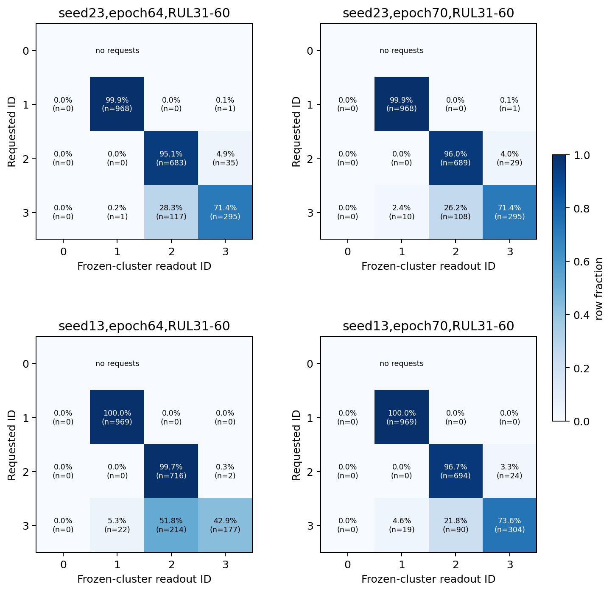
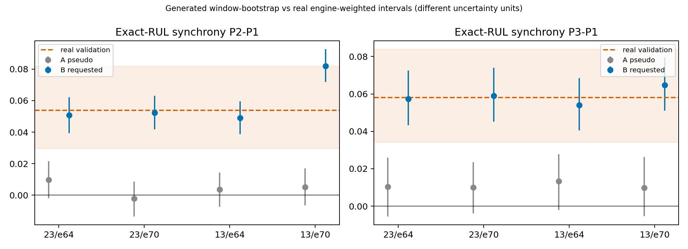

# FD003已有生成样本：原型条件是否落实到输出模式

[Observed] 本轮只读父实验4个B候选和对应4个A样本。指定编号全部保留且独立随机数流回放逐项一致；原始A编号为−1，表中A只用B编号作为未输入模型的伪标签。没有训练、生成、重新聚类或原测试访问。

[Code] 按实际42维传感器统计特征/训练标准化参数/冻结4中心重新分配。生成窗口已经在父实验归一化坐标中，不再拟合或更改MinMax。指定RUL与指定原型用于分组，绝不作为重识别输入。

## 主表：31–60指定编号与重识别

| 生成器种子 | 轮次 | 命中率 | 同RUL无关联期望 | 条件κ | 等RUL宏召回 | CMI | 置换CMI均值 | CMI置换p |
|---|---|---|---|---|---|---|---|---|
| 23 | 64 | 92.67% | 38.07% | 0.8816 | 88.36% | 0.8665 | 0.0297 | 0.0010 |
| 23 | 70 | 92.95% | 38.17% | 0.8860 | 88.74% | 0.8540 | 0.0310 | 0.0010 |
| 13 | 64 | 88.67% | 39.18% | 0.8137 | 80.27% | 0.7677 | 0.0301 | 0.0010 |
| 13 | 70 | 93.67% | 38.17% | 0.8976 | 89.89% | 0.8545 | 0.0310 | 0.0010 |

命中率机会值按每个精确RUL的指定占比×输出占比计算；条件κ扣除此机会值。宏召回对每个RUL实际指定类别等权再对RUL等权，P0未指定不虚构召回。CMI是给定精确RUL后指定/输出的关联，不要求类别恰好同号；1000次RUL内置换保留两边各类原占比，校准有限样本偏差。各p值探索性、未多重校正，4个候选共享噪声/编号，不当成4个独立随机实验。

完整混淆计数及行占比：confusion_by_RUL_range.csv；精确RUL混淆：confusion_exact_RUL.csv；单类召回：class_recalls.csv。所有固定轮次/分段含125分别保留，未按命中率选检查点。125只控制截断标签，不代表相同未截断寿命。



## 同RUL同步性是否保留

| 种子 | 轮次 | 指定原型差 | B输出同步性差[固定样本95%区间] | 真实验证差 | B/真实差 | A伪标签差 |
|---|---|---|---|---|---|---|
| 23 | 64 | P2−P1 | +0.0506 [+0.0393,+0.0620] | +0.0538 | 94.2% | +0.0097 |
| 23 | 64 | P3−P1 | +0.0574 [+0.0433,+0.0725] | +0.0581 | 98.8% | +0.0104 |
| 23 | 70 | P2−P1 | +0.0524 [+0.0417,+0.0630] | +0.0538 | 97.4% | -0.0022 |
| 23 | 70 | P3−P1 | +0.0590 [+0.0452,+0.0740] | +0.0581 | 101.5% | +0.0100 |
| 13 | 64 | P2−P1 | +0.0491 [+0.0386,+0.0596] | +0.0538 | 91.3% | +0.0035 |
| 13 | 64 | P3−P1 | +0.0541 [+0.0404,+0.0684] | +0.0581 | 93.0% | +0.0132 |
| 13 | 70 | P2−P1 | +0.0819 [+0.0717,+0.0927] | +0.0538 | 152.3% | +0.0051 |
| 13 | 70 | P3−P1 | +0.0648 [+0.0511,+0.0795] | +0.0581 | 111.5% | +0.0097 |

指标沿用真实诊断：每传感器48步分4季度，找最大季度间变化位置，再取跨14传感器在同一段达到最大变化的最高比例。分组按指定编号，不按事后重识别，防止把聚类本身制造的差异误作条件响应。P2−P1、P3−P1只检查先前真实诊断已复核的方向，支持RUL清单及各类样本量见synchrony_RUL_support.csv。各RUL等权、类别样本量不等不直接累加。

生成区间按精确RUL×指定类别重采样窗口，同一索引用于A/B；它描述固定保存批次的采样波动，不是发动机或生成器训练种子不确定性，生成数据不虚构发动机ID。真实参考区间沿用发动机层随机权重方法；两种区间的统计单位不同。



## 解释范围

- 命中高但与条件机会基线接近，不能说听懂原型；CMI高而命中低，可能是输出随编号改变但并非正确原型，需结合混淆及同步性。
- B相对A总体输出改变不等于原型控制成功，因为两者权重/训练不同。A伪标签关联用于参照有限采样/RUL偏差，不是给A实际加了条件。
- 冻结中心分类器在生成信号上可能外推，距离统计见cluster_distance_diagnostics.csv；远离真实训练分布时，最近编号不能证明真实模式已复现。
- 若指定后的输出模式无相应变化，只能支持条件未被有效利用是贡献因素，不能证明原型本身没有价值或定位唯一原因。若响应存在但用途变差，只说明这种可控性尚不足以改善寿命预测。
- 先前FD003生成实验四个固定配对总体/31–60均退步；本轮无新的下游模型或测试成绩。岭回归正结果和本轮关联均不授权重开扩散训练。

当前→保存样本上的条件响应诊断→论文无同设计指标→论文gap不适用→两种子且共享采样噪声/固定批次限制→严格复现与先前生成负结果保持。固定只读预算结束，不新增实验。

配置：configs/diagnostics/fd003_prototype_condition_adherence.json；协议：docs/operations/FD003_PROTOTYPE_CONDITION_ADHERENCE.md；快照：runs/diagnostic-fd003-prototype-condition-adherence-20261105/manifest.json；结果：results/diagnostics/fd003_prototype_condition_adherence_20261105/。

复现到新目录（工作区根目录）：
```bash
metaindux-ts-reproduction/.venv/bin/python metaindux-ts-reproduction/analysis/diagnostics/diagnose_fd003_prototype_condition_adherence.py --suffix replay1
```
