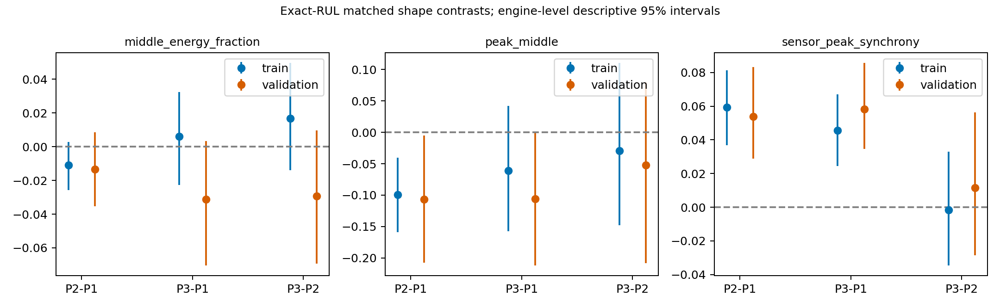
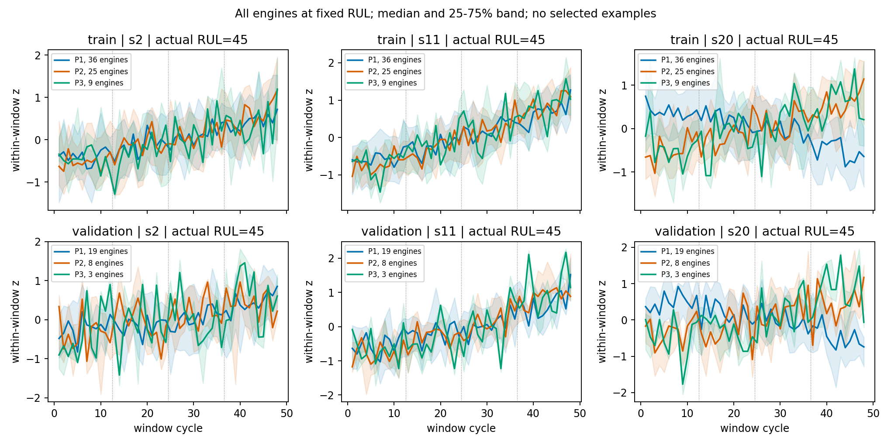

# FD003四类原型：冻结聚类的同RUL诊断与CPU岭回归探针

[Observed] 决策：两项检查都有正向证据（限于预设形态指标和固定岭回归探针）。

[Code] 实际聚类输入是14传感器的均值、标准差(ddof0)、末12周期均值减首12周期均值，共42维。冻结训练StandardScaler与4个KMeans中心分配训练/验证真实窗口ID，不输入RUL。RUL只用于父实验的生成抽样频率，本探针完全不使用该频率。训练ID逐个重算与已有ID一致。

[Observed] 固定70台训练/30台验证，14886/5134窗口；验证原NPZ没有周期/窗口索引，本次从train_FD003原文件和冻结MinMax重建并逐窗口逐标签验证，详见window_indices.csv。没有读原测试集，没有聚类/扩散拟合或生成；仅2次CPU Ridge(alpha1,SVD)拟合。

## 表1：RUL区间与原型（窗口/发动机列均为训练 / 验证）

| RUL区间 | 原型 | 窗口数 | 发动机数 | 同RUL下可复核的曲线差异 |
|---|---|---|---|---|
| 0-30 | 0 | 0 / 0 | 0 / 0 | 无验证窗口，证据不足 |
| 0-30 | 1 | 1147 / 589 | 37 / 19 | 本轮未做此段同RUL曲线检验 |
| 0-30 | 2 | 1023 / 341 | 33 / 11 | 本轮未做此段同RUL曲线检验 |
| 0-30 | 3 | 0 / 0 | 0 / 0 | 无验证窗口，证据不足 |
| 31-60 | 0 | 0 / 0 | 0 / 0 | 无验证窗口，证据不足 |
| 31-60 | 1 | 995 / 514 | 37 / 19 | P2−P1:peak_middle同方向；P2−P1:sensor_peak_synchrony同方向；P3−P1:sensor_peak_synchrony同方向 |
| 31-60 | 2 | 695 / 213 | 33 / 11 | P2−P1:peak_middle同方向；P2−P1:sensor_peak_synchrony同方向 |
| 31-60 | 3 | 410 / 173 | 40 / 17 | P3−P1:sensor_peak_synchrony同方向 |
| 31-40 | 0 | 0 / 0 | 0 / 0 | 无验证窗口，证据不足 |
| 31-40 | 1 | 370 / 190 | 37 / 19 | 仅作支持量检查；效应按31–60内共同RUL估计，未单独检验本子段 |
| 31-40 | 2 | 319 / 101 | 33 / 11 | 仅作支持量检查；效应按31–60内共同RUL估计，未单独检验本子段 |
| 31-40 | 3 | 11 / 9 | 4 / 2 | 少于8台验证发动机，证据不足 |
| 41-50 | 0 | 0 / 0 | 0 / 0 | 无验证窗口，证据不足 |
| 41-50 | 1 | 353 / 181 | 37 / 19 | 仅作支持量检查；效应按31–60内共同RUL估计，未单独检验本子段 |
| 41-50 | 2 | 243 / 81 | 28 / 9 | 仅作支持量检查；效应按31–60内共同RUL估计，未单独检验本子段 |
| 41-50 | 3 | 104 / 38 | 17 / 6 | 少于8台验证发动机，证据不足 |
| 51-60 | 0 | 0 / 0 | 0 / 0 | 无验证窗口，证据不足 |
| 51-60 | 1 | 272 / 143 | 31 / 17 | 仅作支持量检查；效应按31–60内共同RUL估计，未单独检验本子段 |
| 51-60 | 2 | 133 / 31 | 19 / 8 | 仅作支持量检查；效应按31–60内共同RUL估计，未单独检验本子段 |
| 51-60 | 3 | 295 / 126 | 40 / 17 | 仅作支持量检查；效应按31–60内共同RUL估计，未单独检验本子段 |
| 61-90 | 0 | 4 / 10 | 1 / 1 | 少于8台验证发动机，证据不足 |
| 61-90 | 1 | 421 / 163 | 22 / 13 | 本轮未做此段同RUL曲线检验 |
| 61-90 | 2 | 44 / 0 | 8 / 0 | 无验证窗口，证据不足 |
| 61-90 | 3 | 1631 / 727 | 63 / 29 | 本轮未做此段同RUL曲线检验 |
| 91-124 | 0 | 40 / 34 | 2 / 1 | 少于8台验证发动机，证据不足 |
| 91-124 | 1 | 145 / 1 | 9 / 1 | 少于8台验证发动机，证据不足 |
| 91-124 | 2 | 0 / 0 | 0 / 0 | 无验证窗口，证据不足 |
| 91-124 | 3 | 2149 / 867 | 68 / 29 | 本轮未做此段同RUL曲线检验 |
| 125 | 0 | 965 / 213 | 9 / 3 | 少于8台验证发动机，证据不足 |
| 125 | 1 | 51 / 0 | 4 / 0 | 无验证窗口，证据不足 |
| 125 | 2 | 0 / 0 | 0 / 0 | 无验证窗口，证据不足 |
| 125 | 3 | 5166 / 1289 | 63 / 19 | 本轮曲线比较限31–60；125为截断标签单列 |

占比与全部独立发动机ID见counts_by_RUL_prototype.csv；包括31–60整体及其三个互相不重叠子段，主段和子段不可相加。不同原型的发动机计数允许重叠。125不与91–124混算。

## 同RUL曲线比较

[Code] 预设三指标只用中间季度变化：中间变化能量占比、最大变化是否在中间、传感器最大变化发生段的同步率。它们未直接输入聚类，但仍可与聚类统计量相关，不是“新信息/故障机制”的证明。每整数RUL每侧至少3台发动机，严格同RUL不同发动机，无窗口重复匹配；未放宽到±5。按相同RUL分层求差再等权平均；发动机层共享指数随机权重bootstrap2000次，不能把相邻窗口当独立样本。所有比较及区间均为探索性、未多重校正。

| 原型对 | 训练匹配窗对/发动机A,B/RUL数 | 验证匹配窗对/发动机A,B/RUL数 | 支持是否充分 |
|---|---|---|---|
| P0,P1 | 0/0,0/0 | 0/0,0/0 | False |
| P0,P2 | 0/0,0/0 | 0/0,0/0 | False |
| P0,P3 | 0/0,0/0 | 0/0,0/0 | False |
| P1,P2 | 695/37,33/30 | 204/19,11/24 | True |
| P1,P3 | 362/36,40/23 | 149/18,17/19 | True |
| P2,P3 | 247/28,36/23 | 55/8,11/13 | True |

匹配后的两侧RUL分布完全相同，逐RUL数量和实际窗口/发动机列表见matched_RUL_distributions.csv、matched_windows.csv；未在无重叠寿命区域外推。

| 原型差 | 指标 | 训练差值[描述性95%区间] | 验证差值[描述性95%区间] | 方向复核 |
|---|---|---|---|---|
| P2−P1 | middle_energy_fraction | -0.0092 [-0.0245,+0.0051] | -0.0133 [-0.0362,+0.0082] | False |
| P2−P1 | peak_middle | -0.0817 [-0.1453,-0.0199] | -0.1070 [-0.2079,-0.0069] | True |
| P2−P1 | sensor_peak_synchrony | +0.0568 [+0.0321,+0.0805] | +0.0538 [+0.0278,+0.0823] | True |
| P3−P1 | middle_energy_fraction | +0.0068 [-0.0184,+0.0315] | -0.0313 [-0.0685,+0.0031] | False |
| P3−P1 | peak_middle | -0.0756 [-0.1761,+0.0242] | -0.1062 [-0.2145,-0.0021] | False |
| P3−P1 | sensor_peak_synchrony | +0.0493 [+0.0281,+0.0706] | +0.0581 [+0.0340,+0.0840] | True |
| P3−P2 | middle_energy_fraction | +0.0169 [-0.0091,+0.0438] | -0.0292 [-0.0699,+0.0112] | False |
| P3−P2 | peak_middle | -0.0055 [-0.1218,+0.1237] | -0.0526 [-0.2063,+0.0777] | False |
| P3−P2 | sensor_peak_synchrony | -0.0075 [-0.0400,+0.0220] | +0.0116 [-0.0274,+0.0580] | False |





图固定RUL45、s2/s11/s20，全体可用发动机，25–75%区间及中位数；每窗口去均值/除标准差，图例给发动机数。无P0时不画；单发动机曲线不作群体证据。原始水平图curves_RUL45_raw.png只供上下文，不能将聚类已用的均值差当独立形态证据。

## 表2：未见发动机上的预测探针

[Code] A=冻结标准化42统计特征；B=相同42特征+4列未再标准化onehot。两者仅训练一次alpha1岭回归，所有训练RUL含125均参与，不输入RUL/寿命分段/engineID/原型概率，无预测裁剪。相同正则并不消除新增非线性分区基函数的模型表达差异。

| 评价范围 | A组RMSE | B组RMSE | B−A | 改善发动机数 |
|---|---|---|---|---|
| all | 15.6275 | 15.0535 | -0.5740 | 21/30 |
| 0-30 | 14.4946 | 12.4582 | -2.0363 | 26/30 |
| 31-60 | 19.4669 | 16.7320 | -2.7349 | 25/30 |
| 31-40 | 17.6937 | 13.2356 | -4.4581 | 28/30 |
| 41-50 | 19.5493 | 15.5990 | -3.9503 | 26/30 |
| 51-60 | 21.0152 | 20.5272 | -0.4879 | 16/30 |
| 61-90 | 15.9821 | 19.4324 | +3.4502 | 3/30 |
| 91-124 | 11.0313 | 10.5845 | -0.4468 | 18/30 |
| 125 | 15.1001 | 12.3475 | -2.7526 | 17/20 |

主口径为每发动机先平均窗口平方误差、再发动机等权平均后开方；不是窗口加权或平均预测的集成结果。预测完成后才按真实RUL分段。全范围及31–60的发动机贡献：

- all: B−A描述性95%区间[-1.1523,-0.0437]；改善21/30台；正向MSE降幅中前三台[100, 74, 13]占39.3%，去掉这三台后的RMSE差-0.2582；极少数拉动标志=False。正向贡献比例的分母不含退步者，不能当净收益比例。
- 31-60: B−A描述性95%区间[-4.0379,-1.5910]；改善25/30台；正向MSE降幅中前三台[100, 95, 12]占27.1%，去掉这三台后的RMSE差-2.1730；极少数拉动标志=False。正向贡献比例的分母不含退步者，不能当净收益比例。

原型是原始统计特征的确定性分类，不增加传感器信息；若B改善，只支持这种非线性分区让固定线性预测器更易利用已有信息。单一alpha/固定模型/既有内部划分、窗口高度重叠均限制推广；置信区间只按发动机描述，不增加模型拟合次数。

**决策：两项检查都有正向证据（限于预设形态指标和固定岭回归探针）。** 原型0在31–60无支持，稀少原型/子段明确不足；不得外推为所有原型、故障类型或因果退化机制。无论探针是否改善，已完成的扩散生成负结果保持，不证明扩散模型用好了原型，也不证明生成数据用途改善。

当前诊断→论文无该探针/形态目标→论文数值差距不适用→跨发动机方向与不确定性见表→严格复现及已有生成实验结论不变。固定预算2个CPU回归已结束，无调参或新增实验。

复现（工作区根目录）：
```bash
metaindux-ts-reproduction/.venv/bin/python metaindux-ts-reproduction/analysis/diagnostics/diagnose_fd003_prototypes.py
# 既有产物不覆盖；完全相同配置重跑到新目录：
metaindux-ts-reproduction/.venv/bin/python metaindux-ts-reproduction/analysis/diagnostics/diagnose_fd003_prototypes.py --suffix replay1
```

配置：configs/diagnostics/fd003_prototype_probe.json；协议：docs/operations/FD003_PROTOTYPE_PROBE.md；快照：runs/diagnostic-fd003-prototype-probe-20261103/manifest.json；表/预测/模型/图：results/diagnostics/fd003_prototype_probe_20261103/。
